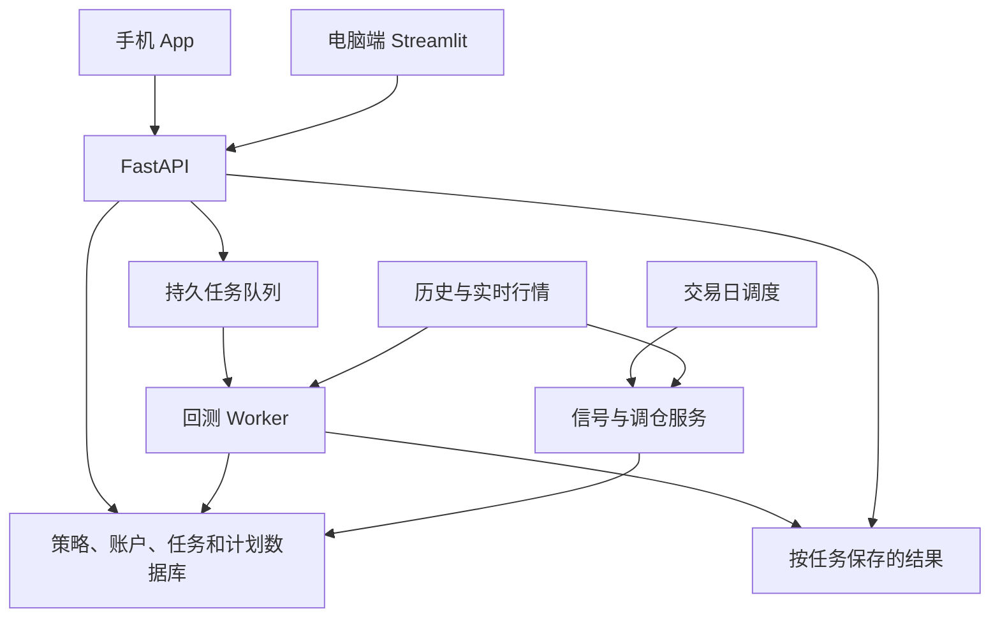

# 手机 App 与服务端 API 设计

整理日期：2026-10-14。本文是功能与接口设计草案，接口尚未实现。

## 1. 范围与职责

用户确认：手机端也可以配置和发起回测，服务端提供 API。

手机端提供策略研究、回测、每日信号、调仓计划、持仓与模拟成交管理。服务端负责行情、策略计算、异步回测任务、数据存储和定时计划生成。电脑端 Streamlit 保留，逐步复用相同服务与结果。

第一版覆盖当前三种回测类型：ETF 攻守轮动、因子策略、LightGBM + Alpha158。可以分阶段接入，但所有回测类型均属于手机端功能范围，未接入的引擎要明确标记状态。

本设计不包括券商自动下单。手机平台尚未确定；若同时支持 iOS 和 Android，建议 Flutter；若仅 iPhone，可采用 SwiftUI。

## 2. 手机导航与页面

建议底部五个入口：今日、回测、策略、持仓、我的。

| 入口 | 内容 |
|---|---|
| 今日 | 盘中预览、14:45–14:50 尾盘计划、收盘确认、行情时间、计划执行状态 |
| 回测 | 新建任务、运行中任务、历史结果、结果比较 |
| 策略 | 保存的策略与参数版本，查看、复制、修改后回测，启用每日监控 |
| 持仓 | 策略账户范围、持仓、可卖数量、资金、手动成交和模拟交易记录 |
| 我的 | 账号、提醒设置、服务状态、主题、隐私与本地缓存设置 |

调仓计划详情从“今日”进入，也可从策略详情进入。回测结果详情从“回测”进入。

### 回测新建流程

1. 选策略类型或保存的策略。
2. 填标的或股票池、日期、初始资金及核心参数。
3. 展开高级设置：基准、费用、滑点及执行时点等受支持配置。
4. 确认运行摘要，查看数据覆盖范围和缺失提示，然后提交。
5. 查看排队、运行阶段、失败原因或完成结果。

不同策略展示不同参数，不把所有参数堆在同一页：轮动配置进攻/防守标的与周期；因子配置表达式、方向与 Top-K；AI 配置训练/验证/测试区间及模型参数。

可先用“基础 / 高级”折叠区域减少输入量；数字用数字键盘，日期用日期选择器，错误显示在对应字段附近。目标触控面积至少满足 iOS 44pt 或 Android 48dp。

### 运行中任务

点击运行后立即返回任务详情，显示“排队中 / 准备数据 / 训练模型 / 模拟撮合 / 生成报告”等真实阶段。只有引擎能报告总量时才显示百分比；未知进度时不要编造百分比或预计完成时间。

关闭 App 不取消任务。再次打开后可以找回任务。网络断开只改变手机连接状态，不能据此将服务端任务标记为失败。

支持请求取消；运行任务需待执行器确认后才标记取消，不能把点击按钮等同于已停止。失败任务可以按原配置重试，但会产生新的任务 ID。

### 回测结果

- 首屏：累计收益、年化收益、最大回撤、标准日超额收益口径的夏普、实际回测区间和数据截止日期。
- 净值与基准曲线、单独回撤图；按日期范围缩放，点击或拖动查看某日值，不依赖鼠标悬停。
- 年度 / 月度收益，持仓变化，分页交易明细，单标的买卖点。
- 策略参数、数据版本、执行时点、费用和警告，CSV 导出。
- 复制参数重新回测，最多同时比较 2–3 个结果；不同标的、区间、价格口径或成本不能静默混为同口径比较。

长明细采用分页或虚拟列表。图表可下采样降低传输量，但绩效指标必须用服务端完整原始收益计算，回撤图下采样应保留区间极值。

## 3. API 与异步任务架构

建议：FastAPI + 关系数据库 + 持久任务队列 / Worker；初期可单机部署，按实际任务量扩展。Redis 与 Celery/RQ 是可选实现，不是手机开发的先决条件。



API 处理提交、校验和查询，耗时计算交给独立 Worker。不能在普通请求中等待整个回测，也不能只使用 Web 请求进程内的临时后台任务保证长任务可靠性。

任务状态建议为 queued、running、cancel_requested、succeeded、failed、cancelled。保存阶段、时间、配置快照、错误摘要和结果位置。

API、Worker 或机器重启后，通过持久记录、任务租约/心跳和超时策略识别中断，显式重试或失败，不能永远显示“运行中”。资源限额可配置，AI 模型训练与尾盘实时服务应隔离，避免回测占满 CPU/内存影响 14:50 计划。

### 回测 API 草案

统一前缀 `/api/v1`。

| 方法与路径 | 行为 |
|---|---|
| GET /backtest-engines | 返回支持的引擎、参数规则、能力与数据覆盖范围 |
| POST /backtests | 校验配置后提交任务，返回 HTTP 202 与任务 ID |
| GET /backtests | 当前用户任务列表，支持状态筛选与分页 |
| GET /backtests/{id} | 状态、当前阶段、时间和错误摘要 |
| POST /backtests/{id}/cancel | 请求取消，返回当前状态 |
| POST /backtests/{id}/retry | 以原配置提交一个新任务 |
| GET /backtests/{id}/summary | 完成任务的指标、配置与数据版本 |
| GET /backtests/{id}/series | 指定日期和分辨率的净值、基准与回撤 |
| GET /backtests/{id}/trades | 分页交易明细 |
| GET /backtests/{id}/exports/{type} | CSV 等导出，校验用户访问权限 |

任务仍在运行时，结果端点返回明确的“结果尚未就绪”状态，不展示其他任务或之前运行的旧报告。非法参数返回字段错误；服务过载返回可重试的明确响应。

示意请求，费用是小数比例，0.00025 表示单边万2.5：

```json
{
  "engine": "rotation",
  "engine_version": "rotation-v1",
  "parameters": {
    "attack_symbol": "sz159915",
    "defense_symbol": "sh512890",
    "lookback": 20
  },
  "start_date": "2019-03-26",
  "end_date": "2026-10-09",
  "initial_cash": 100000,
  "benchmark": "sh000300",
  "execution": {"mode": "next_open"},
  "costs": {"buy_rate": 0.00025, "sell_rate": 0.00025, "slippage_rate": 0}
}
```

每个参数都必须有真实引擎支持，不支持的执行模式或费用配置应拒绝，不能接受后忽略。示例中的 next_open 需要改造现有轮动引擎后才能使用。

`POST /backtests` 使用 Idempotency-Key。相同用户、相同键与相同内容返回同一个任务；相同键不同内容返回冲突，避免手机超时后重试或连点造成重复训练。

手机先采用有限频率轮询，例如任务详情页每 3–5 秒，后台停止轮询，回到前台再查状态。后续可加 SSE/WebSocket 与完成通知；手机 App 后台运行能力不作为任务继续执行的保证。

### 其他核心 API 草案

| 方法与路径 | 行为 |
|---|---|
| GET /strategies | 策略列表 |
| POST /strategies | 保存配置，生成版本 |
| GET /strategies/{id} | 配置、版本及每日监控状态 |
| PATCH /strategies/{id} | 修改后创建新版本，旧结果仍关联原版本 |
| GET /accounts | 账户及策略资金范围列表 |
| GET /accounts/{id}/positions | 持仓、可卖数量、现金和版本 |
| PUT /accounts/{id}/positions | 更新持仓，校验版本冲突 |
| GET /strategies/{id}/signals | 指定日期的信号，明确类型与有效性 |
| GET /accounts/{id}/plans | 调仓计划列表 |
| GET /plans/{id} | 快照、买卖清单、限制与状态 |
| POST /plans/{id}/executions | 幂等记录实际成交，事务内更新账户 |
| GET /health | 基础服务健康；详细运行状态另行鉴权 |

信号没有行情或计划未生成时，返回明确状态；禁止临时拼出一个看似有效的防守信号。

## 4. 结果隔离与可复现性

当前 app.py 会写入三个固定 CSV；run_quant_pipeline.py 也有固定指标输出。多任务 API 必须改为独立目录，例如 `runtime/backtests/{job_id}/`，数据库保存所有者与关联信息。

每次结果固定关联：策略/引擎版本、代码版本、原始参数、数据版本/哈希与价格口径、实际日期范围、随机种子（适用时）、执行和成本假设。共享历史数据应只读并版本化，不能在任务运行中被更新而悄悄改变输入。

Qlib 初始化和机器学习配置可能含进程级状态，不应在同一个进程内随意并发不同任务。优先独立 Worker 进程和明确的任务上下文，训练日志、模型与 MLflow 记录均按任务隔离。

账户 JSON 改为数据库，避免并发覆盖。用户持仓、任务结果、下载文件均需通过 API 校验所有者，不直接公开运行目录。手机保存的认证信息使用平台安全存储，服务使用 HTTPS。

因子表达式先做语法与可用运算白名单校验，并限制数据量/运行资源；不把用户字符串拼成 shell 命令或交给不受限的 Python eval。

## 5. 与尾盘计划需求的衔接

尾盘业务规则参见 daily_rebalance_plan_spec.md。手机回测不改变已讨论的 14:45–14:50 当日决策窗口、实际持仓比较、手动成交与收盘复核要求。

保存一个回测配置与启用每日监控是两步操作。回测完成不能自动改变正在监控的策略版本、实际持仓或真实调仓计划。启用新版本需展示变更摘要。

现有日线回测不等于尾盘回测。尾盘执行模式依赖分钟历史数据与正确时间戳；无数据时标为不可用，不能用当日最终收盘价代替 14:50 价格。

## 6. 建议交付顺序与验收

1. 提取回测服务，建立任务、结果和行情版本模型；先跑通轮动回测 API。
2. 做手机“回测配置 → 提交 → 任务状态 → 结果 → 历史”闭环，同时接入今日与持仓。
3. 接入因子与 AI 回测；各自具有适用的数据范围、任务资源限制和配置校验。
4. 补齐比较、导出、取消、重试、每日监控、尾盘提醒与收盘复核。

必须验证：同一配置 API 与既有引擎结果一致；两个不同任务不会覆盖结果；重复提交不会创建重复任务；App 关闭后任务继续；网络恢复可找回任务；错误显示可处理原因；跨用户不能读取或下载别人的数据；回测不修改账户；长任务不阻塞尾盘计划；无数据不能伪造已验证回测。

最终交付包含 OpenAPI 文档、移动端页面、后端启动方式、Worker 启停方式、示例配置及上述场景的测试。实际开发技术栈和部署位置在实施前确定，不凭空宣称服务已部署。
